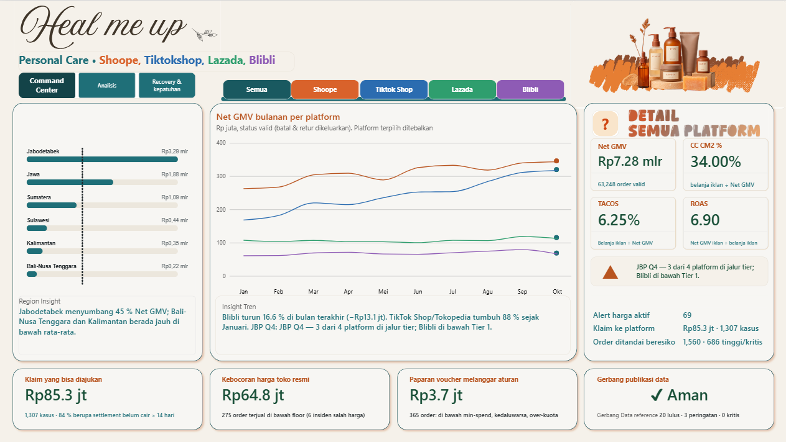
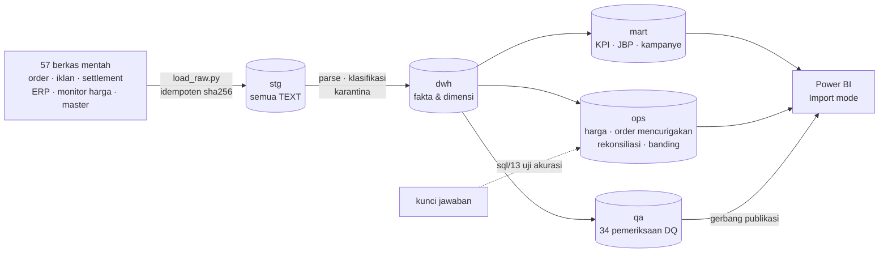

# Lumina Care — Portofolio E-Commerce Data Analyst (Personal Care)

Proyek *end-to-end* untuk peran **E-Commerce Data Analyst**: dari data ekspor mentah empat marketplace sampai dashboard Power BI yang menjawab
pertanyaan bisnis harian (GMV, iklan, voucher, kampanye, JBP) **dan** pekerjaan "penjaga uang": pemantauan harga/promo, order mencurigakan,
rekonsiliasi dan klaim ke platform, serta gerbang kualitas data.

> **Semua data sintetis dan fiktif** (merek, tarif, kontrak, angka). Data kotor disuntikkan dengan sengaja dan **kunci jawabannya disimpan**,
> sehingga akurasi deteksi bisa diuji secara objektif (recall/precision), bukan sekadar terlihat masuk akal.

| | |
|---|---|
| Cakupan | Shopee, TikTok Shop/Tokopedia, Lazada, Blibli · 36 SKU Personal Care · 1 Jan – 31 Okt 2026 |
| Volume | 57 berkas mentah, ±465 ribu baris; 69.250 baris order (63.248 order valid) |
| Stack | PostgreSQL 14+ (diuji di 16, dijalankan pemilik proyek di 18), SQL murni, Python 3 (pemuat berkas & generator), Power BI Desktop (DAX, Power Query, Deneb/Vega-Lite) |



---

## 1. Persyaratan → bukti di repo

| Kebutuhan pekerjaan | Apa yang dibuat | Di mana |
|---|---|---|
| Dashboard GMV, iklan, voucher, promo, JBP, kampanye | Mart KPI + 250 measure DAX + halaman Command Center & Analisis | `sql/07`, `sql/14`, `powerbi/` |
| Ekstraksi data otomatis | Pemuat idempoten (sha256), orkestrasi refresh, log pipeline | `automation/`, `sql/12` |
| Pemantauan harga & promo, kepatuhan | Alert, episode pelanggaran (*gaps-and-islands*), kebocoran harga toko resmi, pelanggaran aturan voucher | `sql/08` |
| Pemantauan order mencurigakan | 5 aturan berbobot + skor risiko + kluster pembeli | `sql/09` |
| Rekonsiliasi & banding | Selisih settlement/ERP, benefit program, paket klaim | `sql/10`, halaman Recovery & Kepatuhan |
| Integritas data | Karantina, 34 pemeriksaan DQ, gerbang publikasi, uji vs kunci jawaban | `sql/03`, `sql/11`, `sql/13` |

## 2. Temuan utama (dari data latihan)

| Ukuran | Nilai |
|---|---|
| Net GMV Jan–Okt 2026 | **Rp7,28 miliar** (Shopee 3,09 mlr · TikTok Shop 2,44 mlr · Lazada 1,07 mlr · Blibli 0,68 mlr) |
| Bulan terbaik / terakhir | September Rp848,9 jt / Oktober Rp838,9 jt |
| **Uang yang bisa ditagih ke platform** | **Rp85,27 jt dari 1.307 kasus**; 84 % berupa settlement belum cair > 14 hari |
| Benefit program kurang bayar | Rp12,5 jt (mis. rebate kuartalan Shopee Q2 kurang Rp7,4 jt; Blibli Q2 belum dibayar Rp3,2 jt) |
| Kebocoran harga toko resmi | Rp64,8 jt pada 275 order terjual jauh di bawah harga lantai (insiden salah harga) |
| Pelanggaran voucher | 365 order, paparan Rp3,7 jt (di bawah min-spend, over-kuota, dipakai setelah kedaluwarsa) |
| Pelanggaran harga | 452 episode; 315 di antaranya dari reseller, bukan toko resmi |
| Order berisiko | 1.560 order: 84 kritis · 602 tinggi · 513 sedang · 361 rendah |
| Gerbang publikasi data | **Aman**: 20 pemeriksaan lulus, 3 peringatan, 0 kritis |

Semua angka di atas dicocokkan langsung dengan database (`sql/13` dan kueri kontrol di `docs/PROSES_PENGERJAAN.md`).

## 3. Arsitektur



Prinsip yang dipegang: staging **tanpa transformasi** (semua teks), pembersihan dan klasifikasi hanya di SQL yang bisa diuji,
baris bermasalah **dikarantina dan dicatat** (tidak dibuang diam-diam), dan setiap angka dashboard bisa ditelusuri ke satu *view*.

## 4. Dashboard Power BI

Dibangun mengikuti referensi desain; berkas `.pbix` **tidak** disertakan (lihat bagian keterbatasan), tetapi seluruh model, measure, spesifikasi visual kustom,
dan langkah pembuatan tersedia di repo.

| Halaman | Isi |
|---|---|
| **Command Center** | Kartu per platform (Net GMV, CM2, TACOS, ROAS, order valid), tren Net GMV bulanan per platform, peringatan JBP, "uang di meja", insight dinamis |
| **Analisis** | Tab Net GMV / Margin (CM2) / Iklan yang mengubah kartu, grafik, dan warna; variasi vs bulan lalu; *Top 5 naik / Top 5 turun* SKU berdasar selisih Rp; sub-kategori penopang; sorotan bulan tertinggi |
| **Recovery & Kepatuhan** | Uang yang bisa diselamatkan per platform & kategori, benefit program dibayar vs seharusnya, kepatuhan harga & promosi, pelanggaran voucher, order berisiko menurut tingkat dan aturan, gerbang publikasi |

Fitur interaksi: slicer platform dan bulan, tombol tab berbasis *bookmark*, palet standar / ramah buta warna, tombol "?" catatan cakupan data
(dua tombol bertumpuk sebagai pengalih), visual Deneb (batang berlabel di atas batang, garis rata-rata).

Halaman yang sudah dirancang tetapi belum dibangun (peta jalan): Iklan, Voucher, Kampanye & JBP, Kepatuhan harga rinci, Kesehatan data.

## 5. Keputusan teknis yang layak dibahas saat wawancara

1. **Peringkat naik/turun memakai selisih Rupiah, bukan persen**, dengan ambang basis minimum Rp5 jt agar SKU kecil tidak mendominasi dengan persentase ekstrem. Dari 36 SKU di katalog, hanya yang lolos basis pada bulan terakhir yang diperingkat.
2. **Pola DAX anti-"PLACEHOLDER"**: ukuran tidak boleh dipakai langsung sebagai filter boolean di `CALCULATE`; simpan dulu di `VAR`. Pola ini dipakai di seluruh measure kartu per platform.
3. **Measure terkunci bulan** (`ALL(DimMonth)` + filter bulan eksplisit) agar kartu dan tabel tidak ikut slicer yang tidak relevan, lalu `Bulan Pilih` untuk bagian yang memang harus mengikuti dropdown.
4. **Peringkat dua kolom** (`RANKX` atas `ALLSELECTED(produk, sub-kategori)`) sehingga peringkat tidak berulang per kategori.
5. **Skor risiko transparan**: bobot R1 40, R2 35, R3 40, R4 50, R5 15; ambang Kritis ≥ 80, Tinggi ≥ 50, Sedang ≥ 30. Level dibedakan oleh bentuk dan kata, bukan hanya warna (aksesibilitas).
6. **Rasio iklan hanya dari baris dengan *spend* andal** (ROAS/CPC), karena sebagian baris mentah rusak.
7. **Tabel kontrol tanpa relasi** (`TabSel`, `Palette`, `Aturan`, `TopN`): relasi otomatis antar kolom bernama sama (`urut`) pernah mempersempit daftar slicer; relasi dihapus dan deteksi otomatis dimatikan.
8. **View pembungkus untuk materialized view**: Navigator Power BI tidak menampilkan `MATERIALIZED VIEW`, sehingga `mart.v_sales_daily` membungkus `mart.mv_sales_daily`.

## 6. Validasi

- **Kunci jawaban** (`answer_key/`): recall 100 % untuk order mencurigakan, pelanggaran voucher, semua selisih settlement/ERP, dan kekurangan benefit program; 98,1 % untuk snapshot pelanggaran harga
  (selisih berasal dari snapshot rusak yang tak terpulihkan). GMV bersih per platform-bulan cocok dengan kunci; selisih ≤ 0,07 % berasal dari order yang dikarantina.
- **Uji tie-out di Power BI**: total `Net GMV` di model sama dengan `SUM(net_gmv)` di `mart.v_kpi_platform_month` (Rp7.280.003.300).
- **Uji mandiri fungsi parsing**: `etl.selftest()` (13 uji).
- **Idempoten**: menjalankan pipeline kedua kali membuat semua berkas `SKIP` dan hasilnya identik.

## 7. Struktur repo

| Folder | Fungsi |
|---|---|
| `data/raw/` | 57 berkas ekspor mentah per platform |
| `answer_key/` | Kunci jawaban anomali & KPI bersih |
| `sql/` | 00–14 + `run_all.sql` |
| `automation/` | `load_raw.py`, `run_pipeline.sh` (Linux/macOS), `run_pipeline.ps1` (Windows) |
| `powerbi/` | `measures.dax` (82), `measures_dashboard.dax` (168), `power_query.pq`, tema (`lumina_theme.json`, `lumina_theme_buta_warna.json`), `deneb/*.vl.json` |
| `docs/` | `PROSES_PENGERJAAN.md`, `DAX_REFERENSI.md`, `MODEL_POWERBI.md`, kamus KPI & data, panduan Word |
| `gen/` | Generator data sintetis dan skrip dokumen (opsional) |

## 8. Cara menjalankan

```bash
# 1) sekali, sebagai superuser
psql -U postgres -f sql/00_create_database.sql
psql -U postgres -d ecom_lumina -c "CREATE ROLE ecom LOGIN PASSWORD 'ecom'; GRANT ALL ON DATABASE ecom_lumina TO ecom;
  GRANT ALL ON SCHEMA stg, etl, dwh, mart, ops, qa TO ecom; ALTER SCHEMA stg OWNER TO ecom; ALTER SCHEMA etl OWNER TO ecom;
  ALTER SCHEMA dwh OWNER TO ecom; ALTER SCHEMA mart OWNER TO ecom; ALTER SCHEMA ops OWNER TO ecom; ALTER SCHEMA qa OWNER TO ecom;"
# 2) sekali: tabel staging (mengosongkan stg + reset registri)
PGPASSWORD=ecom psql -h 127.0.0.1 -U ecom -d ecom_lumina -f sql/01_staging_ddl.sql
# 3) pipeline lengkap (muat -> bersihkan -> mart -> ops -> DQ -> uji akurasi), ±80 detik
PGPASSWORD=ecom ./automation/run_pipeline.sh          # Windows: .\automation\run_pipeline.ps1
```

Power BI: Get data → PostgreSQL, **Server** `127.0.0.1:5432`, **Database** `ecom_lumina`, mode **Import**. Urutan lengkap ada di `docs/MODEL_POWERBI.md`.

## 9. Modul SQL

| Berkas | Isi |
|---|---|
| 01 | DDL staging (semua TEXT) + registri berkas |
| 02 | Fungsi parsing (tanggal/angka multi-format, normalisasi SKU/teks/kota) + 13 uji mandiri |
| 03 | Karantina, hasil DQ, log ETL, kasus banding, toleransi rekonsiliasi |
| 04 | Dimensi & referensi (SKU, listing, voucher, kampanye, kontrak, JBP, kota fuzzy) |
| 05 | Transformasi order: parse → klasifikasi → karantina → `fact_order_line` → `fact_order` |
| 06 | Transformasi iklan, settlement, ERP, statement program, snapshot harga |
| 07 | **Mart KPI**: GMV, CM1/CM2, iklan (ROAS/TACOS), voucher, kampanye vs baseline, JBP + pacing, paritas harga, pembeli berulang |
| 08 | **Kepatuhan harga & promosi**: alert, episode (*gaps-and-islands*), kebocoran harga, aturan voucher |
| 09 | **Order mencurigakan**: 5 aturan + skor risiko + kluster pembeli |
| 10 | **Rekonsiliasi & banding**: settlement, ERP, benefit JBP, paket banding |
| 11 | **Kualitas data**: 34 hasil pemeriksaan, gerbang publikasi |
| 12 | Orkestrasi refresh, log pipeline, kesegaran sumber |
| 13 | Uji akurasi vs kunci jawaban |
| 14 | **View dashboard**: total bulanan + variasi, SKU naik/turun, sub-kategori, Command Center, uang di meja |

## 10. Keterbatasan & catatan jujur

- Data **fiktif**; jangan dipakai sebagai acuan tarif platform sebenarnya.
- Berkas `.pbix` tidak disertakan. Measure DAX, spesifikasi Deneb, dan langkah halaman disusun dan diperiksa nilainya terhadap database, tetapi sebagian ditulis tanpa Power BI Desktop
  di lingkungan penyusun; yang berjalan di Power BI sudah diuji pemilik proyek pada halaman Command Center, Analisis, dan sebagian Recovery & Kepatuhan.
- Animasi geser/putar khas dashboard referensi tidak tersedia secara bawaan di Power BI; interaksi dibuat dengan *bookmark* dan tombol.
- ID order TikTok yang rusak (notasi ilmiah) dikarantina dan tidak dipulihkan; selisih GMV akibat itu ≤ 0,07 %.
- Pengaturan desimal teks (`FORMAT`) mengikuti pengaturan regional komputer (Indonesia: koma desimal).
- "Real-time" disimulasikan: pola idempoten + log + gerbang kualitas yang berlaku juga pada sumber live.

## 11. Dokumentasi

- [`docs/PROSES_PENGERJAAN.md`](docs/PROSES_PENGERJAAN.md): kronologi, keputusan, masalah dan solusinya
- [`docs/MODEL_POWERBI.md`](docs/MODEL_POWERBI.md): tabel, relasi, tabel kontrol, kolom hitung, bookmark, Deneb
- [`docs/DAX_REFERENSI.md`](docs/DAX_REFERENSI.md): seluruh measure per kelompok
- [`docs/KPI_dictionary.md`](docs/KPI_dictionary.md), [`docs/data_dictionary.md`](docs/data_dictionary.md)
